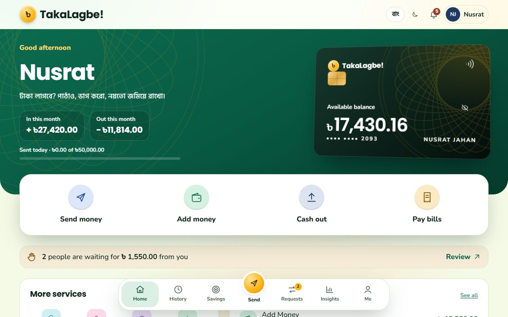
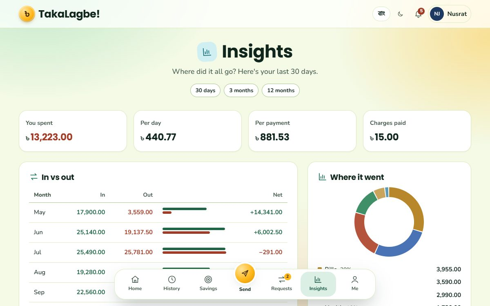

# TakaLagbe!

[](https://github.com/FaiazPronoy/TakaLagbe/actions/workflows/tests.yml)

**A digital wallet and money transfer system, built with PHP and MySQL.**
Send money, pay bills and tuition, recharge, save for goals and split bills,
with an admin console to run the whole system.

| | |
|---|---|
| **Course** | CSE370: Database Systems, BRAC University |
| **Type** | Group project |
| **Made by** | Faiaz Abrar Zaman Pronoy, Sinthia Khandoker and Jahirul Islam Zishan |
| **Live demo** | https://takalagbe.site.je |
| **Versions** | [v1.0, the first version, and v2.0, the rebuild](https://github.com/FaiazPronoy/TakaLagbe/releases) |
| **History** | Built in Spring 2024 for the course. Rebuilt and published here in October 2026. |

| | |
|---|---|
|  |  |

---

## Features

**Money**
- Send money to anyone, free, up to ৳25,000 at a time
- Add money from a bank or card
- Cash in and cash out at an agent
- Mobile recharge, with the operator found from the number
- Pay electricity, gas, water and internet bills
- Pay university and school fees
- Pay merchants, with cashback

**Everyday**
- Savings goals with a target, a deadline and a progress bar
- Request money, or split a bill between many people
- Favourites for one-tap sending
- Your own QR code to get paid, and a scanner to pay others
- Notifications for everything that happens
- Insights: spending by category, a 6 month trend, and who you send to most
- History with search and filters
- Statements to print as PDF or download as CSV
- A receipt for every transaction

**Admin console**
- Platform overview with charts
- Find, freeze or unfreeze users, and change daily limits
- Manage billers, merchants, institutes and agents
- Answer support tickets
- Audit log and failed sign in attempts

**Also**
- Bangla first, with an English button
- Light and dark mode
- Works on phones, and even with JavaScript turned off

---

## How the money stays safe

- **Every taka moves through one function**, inside a database transaction
- **Both accounts are locked** before a balance is read, so two payments at once cannot overspend
- **Passwords and the 6 digit PIN** are hashed with bcrypt
- **Every query is a prepared statement**, so SQL injection does not work
- **Every form has a CSRF token**, and money forms have a one-time token too
- **5 wrong passwords** lock the number for 15 minutes. **5 wrong PINs** freeze the account.
- Money columns cannot go below zero, enforced by the database itself

---

## Database

- **18 tables**, with foreign keys and CHECK rules
- **Two triggers** keep each biller's total up to date
- One `bill_payments` table for all four bill types
- `user` and `account` are one to one: a wallet cannot exist without its owner

The full design is explained in [docs/design.md](docs/design.md).

---

## Built with

| Part | Tools |
|---|---|
| Backend | PHP 8 (no framework) |
| Database | MySQL |
| Frontend | Hand-written CSS and plain JavaScript (no library) |
| Server | Apache (XAMPP) |
| Tests | A PHP test suite that checks the database after each step, and Playwright |

Fonts are the only thing loaded from outside.

---

## Try it

| Role | Where | Sign in with |
|---|---|---|
| Customer | home page | `01700000001` / `demo1234`, PIN `482915` |
| Second customer | home page | `01800000002` / `demo1234`, same PIN |
| Admin | `/admin_login.php` | `admin` / `admin123` |

The data is made up: 12 people with 6 months of activity. No real money moves.

---

## Run it

You need **XAMPP** (Apache, MySQL and PHP 8).

- **Windows:** double-click `RUN-TakaLagbe.bat`. It copies the app into XAMPP, imports the database and loads the demo data.
- **By hand:**
  1. Copy the `app` folder into `C:\xampp\htdocs\` and rename it `takalagbe`
  2. Start **Apache** and **MySQL** in XAMPP
  3. Import `takalagbe.sql` in phpMyAdmin
  4. Load the demo data:

```bash
C:\xampp\php\php.exe tools\seed_demo.php --yes
```

Then open <http://localhost/takalagbe/>.

---

## Settings

Locally nothing is needed: without `config/local.php` the app uses XAMPP's defaults. On a server, copy `app/config/local.example.php` to `app/config/local.php`. That file is never committed.

| Setting | What it is |
|---|---|
| `DB_HOST`, `DB_PORT`, `DB_NAME` | Where the MySQL database is |
| `DB_USER`, `DB_PASS` | The database login |
| `DEBUG` | `false` on a server, so errors are not shown to visitors |
| `HOSTS` | Host names the app answers to |

The same values can come from environment variables instead (`TKL_DB_HOST`, `TKL_DB_NAME` and so on).

---

## Tests

- `app/tests/e2e.py` runs **108 checks** through the real site, and checks the database after each step
- It fires two payments at the same moment to prove the balance never goes wrong
- `app/tests/browser_checks.py` runs **44 checks**: every page, contrast in both themes, keyboard use, no JavaScript and phone width

---

## Folder layout

```
app/
  *.php          one controller per page
  views/         the page templates, one per controller
  config/        settings, the database connection and request helpers
  lib/           money, bills, QR codes, icons and translations
  assets/        CSS and JavaScript
  tools/         demo data and hosting helpers
  tests/         the test suites
  takalagbe.sql  the database
docs/            screenshots and design notes
```

---

## The team

Faiaz led the project. He designed the database, planned the features, split
them across the team and reviewed each part before it was merged.

- **Faiaz Abrar Zaman Pronoy** (ফাইয়াজ আবরার জামান প্রনয়), lead developer
  - The database design: 18 tables, keys, CHECK rules and triggers
  - The money engine in `lib/money.php`: one transaction per transfer, with both accounts locked
  - Security: bcrypt, prepared statements, CSRF and one-time tokens, lockouts
  - Send money, add money, cash in and out, savings goals, requests and split bills
  - The admin console, and the test suites
- **Sinthia Khandoker** (সিনথিয়া খন্দকার)
  - Bill and tuition payments, and the biller lists
  - Statements and receipts
  - The Bangla translation
- **Jahirul Islam Zishan** (জহিরুল ইসলাম জিশান)
  - Mobile recharge and the QR code pages
  - Notifications and support tickets

## Licence

Copyright 2024-2026 Faiaz Abrar Zaman Pronoy, Sinthia Khandoker and Jahirul Islam Zishan. All rights reserved.
You may read the code and run it to try it out. You may not copy it, hand it in
as your own work, or publish it. See [LICENSE](LICENSE).
